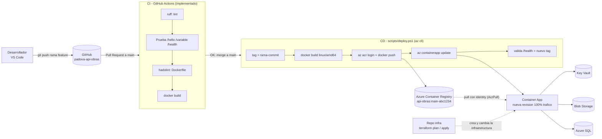

# Flujo CI/CD - api-obras

Pega el bloque en https://mermaid.live y exporta PNG para el documento de entrega.

## Respuestas que pide el PDF

**Desde donde inicia.** En el repositorio de codigo `padova-api-obras`: el desarrollador hace `git push` de una rama y abre un Pull Request hacia `main`.

**Como se gatilla.**
- El Pull Request (y cada push a `main`) gatilla el CI en GitHub Actions (`.github/workflows/ci.yml`): lint del codigo, prueba rapida de endpoints, lint del Dockerfile y `docker build`. Si algo falla, no se hace merge.
- Con el merge a `main`, se ejecuta el CD con `scripts/deploy.ps1`: genera el tag `rama-commit`, construye la imagen, la publica en el ACR y despliega la nueva revision en el Container App con `az containerapp update`. Termina cuando `/health` responde con la nueva version.

**Infraestructura.** Tiene su propio repositorio y su propio ciclo (`terraform plan` y `apply`). Por eso Terraform ignora los cambios de imagen (`lifecycle.ignore_changes`): la infraestructura la cambia Terraform y las versiones de la app las cambia el CD.

**Siguiente paso.** Para que el CD corra solo despues del merge, se pasa el contenido de `deploy.ps1` a un job de GitHub Actions con login federado (OIDC) a Azure. En este trabajo se deja con `az cli` desde la maquina del desarrollador, como recomendo el profesor.
